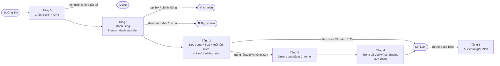

<div align="center">

# 🛡️ Verity — Thẩm định website bằng AI giải thích được

**Dán một đường link → nhận điểm tin cậy 0–100, kèm từng bằng chứng giải thích *vì sao*.**

Phát hiện web lừa đảo (phishing), giả mạo ngân hàng/thương hiệu, cờ bạc trá hình — chạy hoàn toàn trên máy của bạn, không bắt buộc API key.


*Đo trên 1.647 website thật đang hoạt động — [xem cách đo](docs/DANH-GIA.md)*

</div>

---

## Verity khác gì các công cụ kiểm tra link khác?

| Công cụ "hộp đen" thông thường | Verity |
|---|---|
| Chỉ trả lời "An toàn" / "Nguy hiểm" | Liệt kê **từng bằng chứng** và số điểm nó cộng/trừ |
| Chỉ tra tên miền trong danh sách đen | **Đọc nội dung trang**: form mật khẩu, ô OTP, thương hiệu bị giả danh, mã JavaScript làm rối… |
| Web lừa đảo mới tạo hôm qua thì bó tay | **2 mô hình học sâu** tự nhận diện tên miền và nội dung lạ chưa ai báo cáo |
| Gửi link của bạn lên máy chủ bên thứ ba | Chạy **cục bộ**; AI đám mây (Gemini/OpenRouter) chỉ là tuỳ chọn để viết lời giải thích |

**Ví dụ minh hoạ** kết quả cho một trang giả mạo ngân hàng:

```text
Điểm: 0/100 — NGUY HIỂM (lừa đảo)
  −40  Tên miền chứa thương hiệu "vietcombank" nhưng không phải tên miền chính thức
  −35  Giả danh thương hiệu vietcombank: trang yêu cầu đăng nhập trên tên miền lạ
  −25  Yêu cầu thông tin cực kỳ nhạy cảm: ô nhập OTP, số thẻ
  −22  Tên miền mới đăng ký 3 ngày trước
  −20  Mô hình học sâu: tên miền giống tên miền lừa đảo (xác suất 97%)
```

---

## Độ chính xác

Đo trên **1.647 website thật, đang hoạt động** (748 hợp pháp · 375 lừa đảo · 524 cờ bạc, gồm 4 tập A/B/C/D), với tra cứu danh sách đen **tắt**, tức hệ thống phải tự phát hiện. Trong ngoặc vuông là khoảng tin cậy 95%.

| Chỉ số | Kết quả | Ý nghĩa |
|---|---|---|
| **Accuracy** | **96,11%** [95,2 – 97,0] | Tỷ lệ đoán đúng trên tổng số web |
| **Precision** | **97,71%** [96,7 – 98,6] | Khi Verity báo "nguy hiểm", 97,7% trường hợp là nguy hiểm thật |
| **Recall** | **95,11%** [93,7 – 96,5] | Bắt được 95,1% số web nguy hiểm |
| **F1-Score** | **96,39%** [95,5 – 97,3] | Cân bằng giữa Precision và Recall |
| **AUC-ROC** | **98,89%** [98,4 – 99,3] | Khả năng phân biệt web tốt/xấu, không phụ thuộc ngưỡng |
| **FPR** | **2,67%** [1,6 – 3,9] | Tỷ lệ web hợp pháp bị báo nhầm |
| **MCC** | **92,22%** | Chỉ số tổng hợp, phạt cả báo nhầm lẫn bỏ sót |

Toàn bộ dữ liệu đo, kết quả từng web và script tính chỉ số đều nằm trong repo: [`eval/`](eval/). Chi tiết theo từng tập, điểm yếu và cách tự đo lại: **[docs/DANH-GIA.md](docs/DANH-GIA.md)**.

---

## Cách hoạt động — quét nhiều tầng, dừng sớm

Mỗi đường link đi qua tối đa 6 tầng. Ca nào đã rõ ràng thì dừng ngay, nên web phổ biến chỉ mất khoảng 0,2 giây.



| Tầng | Làm gì | Thời gian điển hình |
|---|---|---|
| **0** | Chặn địa chỉ nội bộ (chống SSRF), phân giải DNS | ~50 ms |
| **1** | Tra trong bộ nhớ: 200.000 web phổ biến (Tranco), danh sách đen, tên miền cờ bạc | ~1 ms |
| **2** | Tải HTML, kiểm tra chứng chỉ TLS, tuổi tên miền (RDAP), chạy 2 mô hình học sâu, chấm điểm theo bằng chứng | 0,3–2 s |
| **3** | Chỉ khi trang rỗng hoặc là SPA *và* điểm còn lưng chừng: dựng trang bằng Chrome thật rồi chấm lại | 2–8 s |
| **4** | Chỉ cho ca vùng xám 45–74 điểm: hỏi trọng tài Jev/OpenJev (mặc định tắt) | tuỳ dịch vụ |
| **5** | Khi người dùng bấm "Xem giải thích chi tiết": AI diễn giải bằng lời, **không thay đổi điểm** | 2–15 s |

Chi tiết từng tầng: **[docs/KIEN-TRUC.md](docs/KIEN-TRUC.md)** · Cách tính điểm: **[docs/CHAM-DIEM.md](docs/CHAM-DIEM.md)**

---

## Cài đặt & chạy thử (3 bước)

Cần **Node.js 18 trở lên**.

```bash
git clone https://github.com/gianguyen14/VerityTrust-XAI-Website.git
cd VerityTrust-XAI-Website
npm install --legacy-peer-deps
```

```bash
npm run dev
```

Mở **http://localhost:3000**, dán một đường link và bấm kiểm tra.

> Lần chạy đầu, máy chủ tải danh sách Tranco và các danh sách đen về thư mục `.cache/` (vài chục MB, chạy nền). Trong lúc đó vẫn quét được bình thường.

### Tuỳ chọn: bật AI viết lời giải thích

Không có API key thì Verity vẫn chấm điểm đầy đủ; chỉ phần "giải thích bằng lời" sẽ dùng mẫu soạn sẵn. Muốn AI viết lời giải thích, tạo file `.env`:

```env
GEMINI_API_KEY="khoá-lấy-tại-aistudio.google.com"
# hoặc OPENROUTER_API_KEY="sk-or-..."
```

### Tuỳ chọn: bật trọng tài Jev cho ca vùng xám

[Jev](https://docs.typesafe.ai/introduction) của TypeSafe AI trả lời các câu hỏi có/không kèm xác suất đã hiệu chỉnh. Verity chỉ hỏi Jev với những trang có điểm lưng chừng (45–74). Lấy API key tại [console.typesafe.ai](https://console.typesafe.ai/keys), rồi thêm vào `.env`:

```env
JEV_MODE="api"
JEV_API_KEY="khoá-typesafe"
```

Có máy chủ VerityTrust-Engine (qua cổng OmniRoute) thì đặt `JEV_MODE="veritytrust"` và `VERITYTRUST_ENGINE_KEY`; nên chạy ngầm trước bằng `JEV_SHADOW=true` để đo. Muốn tự host, đặt `JEV_MODE="openjev"` và `OPENJEV_ENDPOINT` trỏ tới một máy chủ tương thích Jev. Chi tiết: [docs/KIEN-TRUC.md](docs/KIEN-TRUC.md#tầng-4--trọng-tài-jev--openjev-tuỳ-chọn).

Toàn bộ biến cấu hình (tắt/bật từng nguồn dữ liệu, trình duyệt headless, trọng tài Jev…) được mô tả trong [`.env.example`](.env.example).

---

## Lệnh thường dùng

| Lệnh | Tác dụng |
|---|---|
| `npm run dev` | Chạy máy chủ phát triển ở cổng 3000 |
| `npm run build` | Build giao diện cho production |
| `npm test` | Chạy bộ kiểm thử engine (favicon, chấm điểm, khiên doanh nghiệp…) |
| `npm run lint` | Kiểm tra kiểu TypeScript |
| `npm run eval:a` … `npm run eval:d` | Đo độ chính xác trên tập A, B, C, D (cần máy chủ đang chạy, xem bên dưới) |
| `npm run eval:metrics` | Tính Accuracy, Precision, Recall, F1, AUC, FPR, MCC từ kết quả đã đo |

Tự đo lại độ chính xác:

```bash
THREAT_FEEDS=off RATE_LIMIT_PER_MIN=0 npm run dev
```

```bash
npm run eval:a && npm run eval:b && npm run eval:metrics
```

---

## Gọi qua API

```bash
curl -X POST http://localhost:3000/api/analyze -H "Content-Type: application/json" -d '{"url":"https://example.com"}'
```

Kết quả gồm `trust_score` (0–100), `status` (`Safe` / `Warning` / `Dangerous`), danh sách `red_flags`, bảng `score_breakdown` và hành trình `pipeline` qua các tầng. Mô tả đầy đủ các endpoint: **[docs/API.md](docs/API.md)**.

---

## Cấu trúc mã nguồn

```text
├── server.ts                 Máy chủ Express: các API, giao diện, giới hạn tần suất
├── server/
│   ├── scanPipeline.ts       Đường ống quét Tầng 0 → 4, dừng sớm
│   ├── netSafety.ts          Tải trang an toàn: chặn SSRF, kiểm tra từng lần chuyển hướng
│   ├── reputation.ts         Tranco, Phishing.Database, OpenPhish, RDAP, Google Safe Browsing
│   ├── domainRules.ts        Phân tích tên miền: typosquat, hosting miễn phí, thương hiệu, cờ bạc
│   ├── evidence.ts           Thu thập bằng chứng: DNS, TLS, HTML, favicon, form, JavaScript
│   ├── riskScoring.ts        Chấm điểm từ bằng chứng (trừ/cộng điểm, trần, sàn)
│   ├── headless.ts           Tầng 3: dựng trang bằng Chrome, mọi request đi qua bộ chặn SSRF
│   ├── jevDecision.ts        Tầng 4: cổng trọng tài Jev / OpenJev
│   ├── hashedMlp.ts          Lõi mạng nơ-ron (viết tay, đã kiểm tra gradient)
│   ├── urlModel.ts           Mô hình học sâu đọc tên miền
│   ├── contentModel.ts       Mô hình học sâu đọc nội dung trang
│   └── models/*.bin.gz       Trọng số đã huấn luyện (lượng tử hoá int8)
├── scripts/                  Huấn luyện mô hình, đo độ chính xác, thu thập dữ liệu, kiểm thử
├── eval/                     Bộ dữ liệu đánh giá + kết quả từng web (xem eval/README.md)
├── docs/                     Tài liệu chi tiết
├── index.html, src/          Giao diện người dùng
└── HANDOFF.md                Nhật ký phát triển
```

---

## Tài liệu

| Tài liệu | Nội dung |
|---|---|
| [docs/KIEN-TRUC.md](docs/KIEN-TRUC.md) | Đường ống quét 6 tầng, luồng dữ liệu, các lớp bảo vệ an toàn |
| [docs/CHAM-DIEM.md](docs/CHAM-DIEM.md) | Điểm được tính thế nào: bảng bằng chứng, trần và sàn điểm |
| [docs/MO-HINH-AI.md](docs/MO-HINH-AI.md) | Hai mô hình học sâu: kiến trúc, dữ liệu huấn luyện, cách huấn luyện lại |
| [docs/DANH-GIA.md](docs/DANH-GIA.md) | Bộ dữ liệu đánh giá, chỉ số chi tiết, điểm yếu đã biết, cách tự đo |
| [docs/API.md](docs/API.md) | Các endpoint, tham số và cấu trúc kết quả |
| [eval/README.md](eval/README.md) | Mô tả từng file dữ liệu kiểm thử |

---

## Căn cứ pháp lý được tham chiếu trong báo cáo

- **Luật An ninh mạng 2018**, Điều 8: các hành vi bị nghiêm cấm trên không gian mạng
- **Bộ luật Hình sự 2015**, Điều 321–322: tội đánh bạc, tổ chức đánh bạc
- **Nghị định 13/2023/NĐ-CP**: bảo vệ dữ liệu cá nhân
- Website thương mại điện tử đã thông báo với **Bộ Công Thương** (online.gov.vn) được ghi nhận là dấu hiệu minh bạch

---

## Lưu ý

Verity là công cụ **hỗ trợ ra quyết định**, không thay thế cơ quan chức năng. Điểm số phản ánh bằng chứng kỹ thuật tại thời điểm quét. Một web lừa đảo mới có thể chưa để lại đủ dấu vết, và một web hợp pháp ít phổ biến có thể bị đánh giá thận trọng. Khi nghi ngờ, hãy liên hệ trực tiếp tổ chức qua kênh chính thức và **không bao giờ cung cấp OTP hay mật khẩu**.

<div align="center"><sub>Verity — vì một không gian mạng minh bạch và an toàn hơn.</sub></div>
